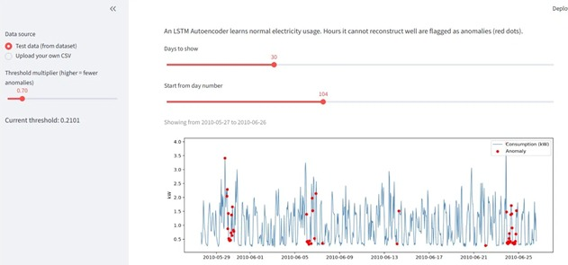
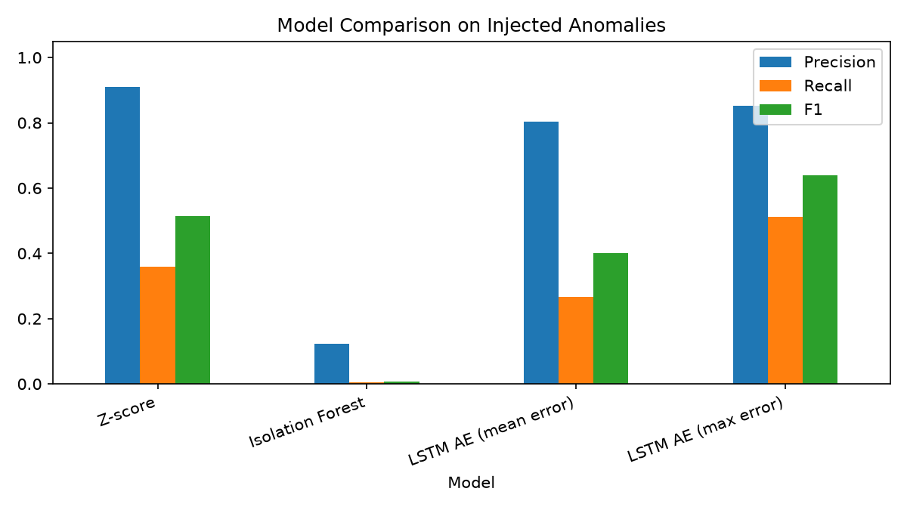

# Smart Meter Anomaly Detection

Anomaly detection in household electricity consumption uses an LSTM Autoencoder and the results are displayed on an interactive Streamlit dashboard.

## Overview

A smart meter records electricity usage over time. Unusual readings, which are anomalies can show appliances, meter problems, theft or power cuts. This project trains an LSTM Autoencoder on 24‑hour consumption patterns. When the LSTM Autoencoder cannot reconstruct a window well and the reconstruction error is high that window is flagged as an anomaly.

## Dataset

The UCI Individual Household Electric Power Consumption dataset contains the Global_active_power column, which has been converted to averages covering 34,589 hours. The raw file is not included because it is too large.

## Method

- Resample data. Interpolate missing values. Split data into 80 percent training and 20 percent testing in order. Scale features with scaling.

- Use sliding windows of 24 hours.

- Train an LSTM Autoencoder. Compute anomaly score as the reconstruction error.

- Set threshold as the 97th percentile of training reconstruction errors.

- Evaluate by injecting 60 artificial anomalies into the test data: 30 spikes and 30 drops, to zero.

## Results

| Method | Precision | Recall | F1-score |
|---|---|---|---|
| Z-score | 0.909 | 0.358 | 0.514 |
| Isolation Forest | 0.122 | 0.004 | 0.007 |
| LSTM AE (mean error) | 0.804 | 0.267 | 0.401 |
| **LSTM AE (max error)** | 0.853 | 0.512 | **0.640** |

## Dashboard

Change the threshold multiplier select a date range or upload your own CSV file of hourly consumption.

## Full report

[Read the project report (PDF)](report/ANN%20project%20report.pdf)

## Run

1. Install the required packages: `pip install tensorflow scikit-learn pandas numpy matplotlib streamlit joblib`

2. Download the dataset using the link above and save it in the folder `data/` with the name `household_power_consumption.txt`.

3. Run the script `python preprocess.py` run the script `python train.py`.

4. Start the dashboard by executing `streamlit run app.py`.

## Limitations

The evaluation uses artificial anomalies and data from only one household.
## Tools

The tools used are Python, TensorFlow/Keras, scikit-learn, Pandas, Matplotlib and Streamlit.
